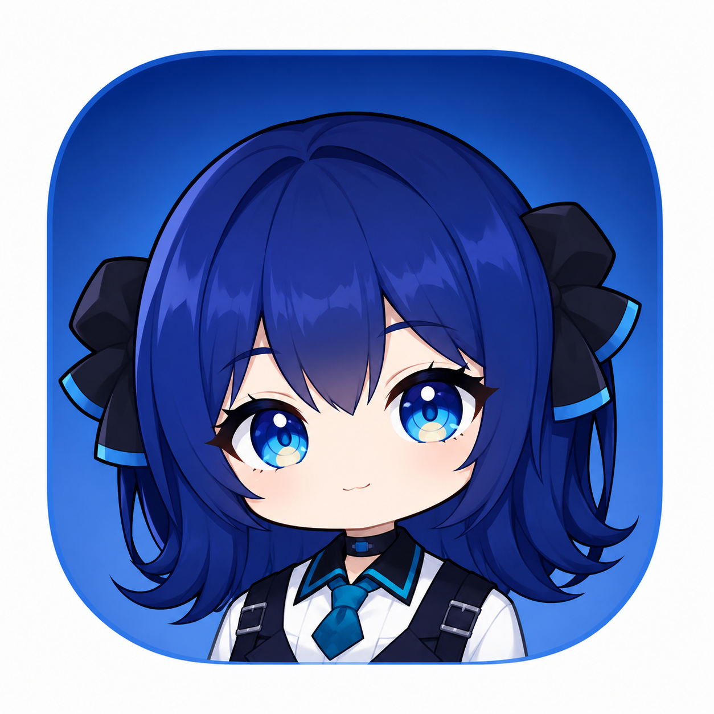
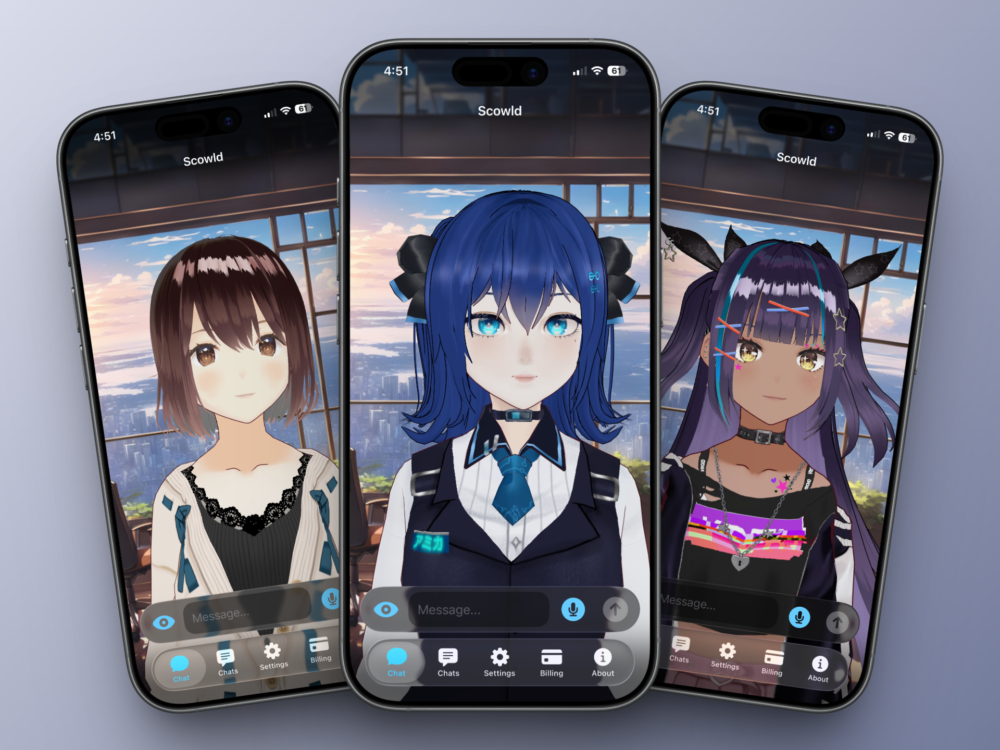

<p align="center">
  
</p>

<h1 align="center">Scowld</h1>

<p align="center">
  An iOS AI voice companion with an animated character you talk to live, hands-free wake mode, bring-your-own-key live voice providers (Google Gemini Live, OpenAI Realtime, xAI Grok Voice), optional vision, and saved conversations.
</p>

<p align="center">
  <a href="https://apps.apple.com/app/id6760672848"></a>
  <a href="https://github.com/apoorvdarshan/scowld/blob/main/LICENSE"></a>
  <a href="https://scowld.xyz"></a>
  <a href="https://www.instagram.com/apoorvcodes/"></a>
  <a href="https://www.producthunt.com/products/scowld"></a>
</p>

<p align="center">
  <a href="https://www.bestpractices.dev/projects/15502"></a>
  <a href="https://scorecard.dev/viewer/?uri=github.com/apoorvdarshan/scowld"></a>
</p>

<p align="center">
  
</p>

## Status

This is the open-source repository for the Scowld iOS app and the marketing website at [scowld.xyz](https://scowld.xyz). Contributions are welcome — see [CONTRIBUTING.md](CONTRIBUTING.md) and [SECURITY.md](SECURITY.md).

## Features

- **Animated companion** - VRM character rendering through the bundled Amica/Arbius frontend, with idle animations and lip sync driven by the live audio.
- **Live speech-to-speech** - Each conversation runs over one live connection to the provider you pick. The provider hears the microphone directly and answers in its own voice; there is no separate speech-to-text or text-to-speech step.
- **Interrupt anytime** - Start speaking while she talks and she stops to listen (barge-in).
- **Typing** - Typed messages go into the live session, and she answers out loud.
- **Hands-free wake mode** - When enabled, the app uses Apple's on-device speech recognition only to listen for Bella or the saved custom companion name, then starts a live session. Nothing is sent to a provider before the session starts.
- **Home tips** - A top-right info button explains the wake phrases and composer controls.
- **BYOK live voice providers** - Google Gemini Live, OpenAI Realtime, and xAI Grok Voice, each with its own models and built-in voices (see below).
- **Vision** - Optional front-camera context with Gemini or OpenAI. Off by default; frames are sent only while the eye is on.
- **Captions** - Optional captions show what she says while she talks.
- **Past chats** - Each turn's transcript is saved on the device, and the active chat is used as context for the next conversation.
- **Ends by itself** - A live conversation ends after 90 seconds of silence (30 seconds for a typed-only one), and when you leave the Chat tab or the app goes to the background.
- **Character settings** - Avatar, custom name, and system prompt controls.
- **Reply language** - Defaults to the iPhone language, with supported language overrides.
- **Local key storage** - Provider API keys are stored in iOS Keychain and sent only to their provider; provider, model, and voice choices are stored in local preferences.
- **Startup onboarding** - Local companion videos and Privacy/Terms acceptance with links to the web policies.
- **About actions** - Update check, rating, share, Product Hunt, an Open Source section (source code, Star on GitHub, and the GitHub bug report and feature request forms), contact, Instagram, X, privacy, and terms.

## Live Voice Providers

| Provider | Models (default first) | Voices | Camera |
|----------|------------------------|--------|--------|
| Google Gemini Live | `gemini-3.8-live`, `gemini-3.8-live-extended-thinking`, `gemini-3.1-flash-live-preview` | 30 built-in voices, Leda by default | A frame about every 2 seconds while the eye is on |
| OpenAI Realtime | `gpt-realtime-2.1-mini`, `gpt-realtime-2.1` | 10 voices, including Marin (default) and Cedar | The latest frame with each thing you say or type |
| xAI Grok Voice | `grok-voice-latest`, `grok-voice-3.0` | Ara (default), Eve, Sal, Rex, Leo | Not supported |

With OpenAI Realtime, what you say is transcribed inside the session (`whisper-1`) so it can be saved to the chat. Users bring their own key for the provider they pick; Scowld runs no server.

## Repo Structure

```
ios/             - iOS app (open ios/Scowld.xcodeproj in Xcode)
ios/ScowldTests/ - Unit tests
ios/ScowldUITests/ - UI tests
web/             - scowld.xyz: static HTML/CSS/JS pages and a Cloudflare Worker
assets/          - README assets
store/           - App Store listing (source of truth) and release switches
scripts/         - Test and release scripts
APPSTORE.md      - App Store Connect reference copy
```

## Architecture

```
Native iOS (Swift/SwiftUI)
├── HomeView              - Main chat UI, composer, and WKWebView bridge
├── HomeTipsSheet         - In-app guide for wake phrases and composer controls
├── LiveConversation      - Turns, barge-in, typing, camera frames, and idle timeouts
├── LiveSession           - The live WebSocket: message order, queued input, Gemini session resumption
├── LiveWire              - Gemini Live, OpenAI Realtime, and xAI Grok Voice protocols
├── LiveAudioEngine       - Microphone with voice processing, playback, lip-sync levels
├── HandsFreeWakeListener - On-device wake word (Apple speech recognition)
├── MemoryStore           - Local CoreData chat history and selected chat context
├── SettingsView          - Live Voice provider, model, voice and key; language, captions, avatar, and prompt
└── AboutView             - App actions, update check, links, and support

WKWebView (bundled Amica/Arbius frontend)
├── Three.js + three-vrm  - 3D avatar rendering
├── VRMA animations       - Idle, gesture, and lip sync animation support
├── Lip-sync bridge       - Page script that feeds the avatar the levels of her natively played voice
└── Native bridge         - JavaScript to Swift message passing

Website (web/, Cloudflare Workers)
├── public/               - Plain HTML, CSS and JavaScript: landing, blog, privacy, terms
└── src/worker.js         - Serves /api/star-history.svg; everything else is static
```

## Requirements

- iOS 17.0+
- Xcode 26+ (CI uses Xcode 27)
- Node.js 22+ for the website tools (the site itself has no build step)
- No Cloudflare environment variables are required for the app's live voice providers or billing services.
- Users bring their own Google Gemini, OpenAI, or xAI API key inside the iOS app.

## Monetization

Scowld is free: there are no subscriptions, paywalls, or credits. About > Support Scowld offers optional one-time tips (consumable in-app purchases from $0.99 to $19.99, managed with RevenueCat) that unlock nothing.

Users are responsible for provider accounts, API keys, provider billing, rate limits, and acceptable use policies for the live voice provider they configure (Google, OpenAI, or xAI).

## Setup

### iOS App

1. Open the Xcode project.
   ```bash
   open ios/Scowld.xcodeproj
   ```
2. Select the Scowld scheme and your device.
3. Build and run from Xcode.
4. After launch, choose a provider in Settings > Live Voice and add its API key.

### Website

The pages in `web/public/` are plain HTML, CSS and JavaScript, edited directly. There is no framework and nothing to compile. Serve them in the local Workers runtime:

```bash
cd web
npm install
npm run dev   # http://localhost:8787
```

Deploy with the configured Wrangler account:

```bash
npm run deploy
```

The deployment targets the `scowld-web` Worker. To serve `scowld.xyz`, first add the domain as a Cloudflare zone and update its registrar nameservers, then add `scowld.xyz` and `www.scowld.xyz` as Worker custom domains.

### Tests

```bash
bash scripts/test-ios.sh
```

Runs the unit (`ScowldTests`) and UI (`ScowldUITests`) tests on a fresh iPhone simulator. GitHub Actions runs them on every pull request that touches the app. Tests never use the network, microphone, camera, or real provider keys. See [docs/ios-testing.md](docs/ios-testing.md).

```bash
cd web && npm ci && npm run lint && npm test && npm run build && npm run smoke
```

Checks the website: ESLint and html-validate, the Vitest suite (including [fast-check](https://fast-check.dev) fuzz properties for the star-history SVG renderer), a site check (`npm run build`) for page metadata, internal links, JSON-LD and the sitemap, and a smoke test that serves the site in the local Workers runtime and requests every sitemap page. The **Website** workflow runs the same steps on pull requests that touch `web/`.

### Security checks

Every pull request also runs [CodeQL](.github/workflows/codeql.yml) (JavaScript, Python, GitHub Actions, and Swift when `ios/` changes) and [dependency review](.github/workflows/dependency-review.yml). [OpenSSF Scorecard](.github/workflows/scorecard.yml) runs on `main` and weekly, Dependabot keeps pinned dependencies current, and releases attach a Sigstore-signed source archive. Report vulnerabilities privately as described in [SECURITY.md](SECURITY.md).

### Releases

Pushing a `v<version>` tag equal to `MARKETING_VERSION` runs the **iOS Release** workflow: the tests, then only the App Store steps switched on with repository variables (upload, listing, What's New, screenshots, App Review submission), then the GitHub Release with a Sigstore-signed source archive. A manual **Run workflow** only validates the signed build with App Store Connect. Every switch is off by default; see [store/README.md](store/README.md). Xcode Cloud was removed for Scowld on 2026-10-14 and must not be re-created.

### Website Environment Variables

The website does not require hosted AI, speech, or billing environment variables. The star-history SVG (`/api/star-history.svg`) reads public stargazer data with a `GITHUB_TOKEN` Worker secret; without it, the endpoint serves a fallback card.

See [web/.env.example](web/.env.example) for defaults.

## Privacy Model

- Provider API keys are entered by the user, stored in iOS Keychain, and sent only to that provider.
- Provider, model, and voice choices are stored locally in app preferences.
- Chat history (each turn's transcript) and selected chat context are stored locally on device.
- While a live conversation is active, microphone audio is streamed continuously to the selected provider, together with typed messages and the selected chat context. The provider answers in its own voice and produces the transcripts. Scowld runs no server in between.
- Hands-free wake detection uses Apple's on-device speech recognition only to listen for the companion's name while the app is open and idle; nothing is sent to a provider before the live session starts.
- Camera access is optional and off by default. Frames go to the selected provider only while the eye is on (not supported with xAI), and Scowld doesn't record or store camera data.
- Providers process what they receive under their own terms and privacy policies.
- Scowld does not use Apple's TrueDepth API or ARKit face tracking and does not collect, use, store, disclose, share, or retain face geometry, depth maps, facial blend shapes, facial expressions, biometric identifiers, or other face data.
- Privacy Policy and Terms are published on the web. Startup onboarding links to the web policies and records acceptance.

## Website Links

- Website: https://scowld.xyz
- Blog: https://scowld.xyz/blog
- Privacy: https://scowld.xyz/privacy
- Terms: https://scowld.xyz/terms
- Instagram: https://www.instagram.com/apoorvcodes/
- Product Hunt: https://www.producthunt.com/products/scowld
- Ko-fi: https://ko-fi.com/apoorvdarshan

## Credits

- Character/avatar frontend: Amica / Arbius AI (MIT)
- Developer: Apoorv Darshan, ad13dtu@gmail.com

## Star History

<a href="https://github.com/apoorvdarshan/scowld/stargazers">
  <picture>
    <source media="(prefers-color-scheme: dark)" srcset="https://scowld.xyz/api/star-history.svg?theme=dark&amp;v=3" />
    <source media="(prefers-color-scheme: light)" srcset="https://scowld.xyz/api/star-history.svg?theme=light&amp;v=3" />
    
  </picture>
</a>

## License

Scowld is released under the [MIT License](LICENSE). The bundled character/avatar frontend (Amica / Arbius AI) is also MIT licensed.
